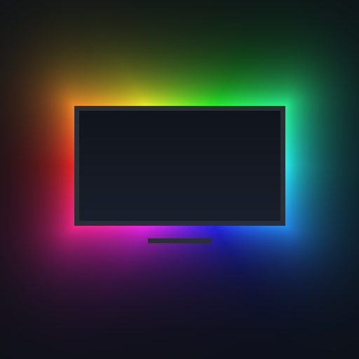

# Hue Ambi

**Native Philips Hue ambilight for Kodi on the Raspberry Pi 5.** No Hue Sync box, no HDMI capture card: a small Rust engine reads the decoded video straight from the display controller and streams one colour per light to a Hue *entertainment area*, each light getting the part of the picture it faces.

<p align="center"></p>

## Why

On a Raspberry Pi 5, LibreELEC/Kodi plays video with the **DRM PRIME "Direct To Plane"** renderer: decoded frames are handed to a hardware plane of the display controller and never pass through OpenGL. Add-ons that rely on Kodi's `RenderCapture` API (such as `script.service.hue`) therefore capture nothing (`CRenderManager::Capture - unknown capture id`), and switching to the EGL renderer costs performance and HDR passthrough.

Hue Ambi takes the video where it actually is: it maps the framebuffer of the video plane through the kernel DRM API and samples it directly, then drives the lights with the Hue **Entertainment API** (DTLS stream, up to 60 updates/s) instead of REST calls.

## Features

- **Per-light colour from the entertainment area layout**: you pick an entertainment area in the Hue app (e.g. "TV"), and each light samples the region of the picture matching its position (left/right, top/bottom).
- **Hue Entertainment API v2** over DTLS 1.2 PSK: low, steady latency, no REST rate limits.
- **HDR10 aware**: BT.2020 PQ is decoded to linear light, converted to BT.709 and soft-clipped around the HDR reference white (203 nits), so HDR films don't wash the room out.
- **Reads the Pi 5 native formats**: Broadcom SAND128 tiled `P030` (10-bit HEVC/HDR) and `NV12`, plus linear `NV12`, `YU12`, `P010`.
- **No Python in the hot path**: the Kodi add-on only configures and supervises a static Rust binary (≈5 MB, no runtime dependency).
- Starts streaming when a video appears on screen, stops half a second after it ends, and gives the lights back to the bridge.
- Migrates the bridge address from `script.service.hue` if it is installed.

## Status

Early, version 0.1.0, in use on one setup (Pi 5, LibreELEC 12.2 / Kodi 21.3, Hue Bridge Pro, 5-light "TV" area).

| Piece | How it was checked |
|---|---|
| End to end on real lights | playback sessions of 15–20 min, steady 47–50 updates/s, no stream drop |
| DTLS PSK handshake + HueStream v2 framing | against an `openssl s_server -dtls1_2 -psk` test bridge (handshake ≈5 ms), then the real bridge |
| Rust engine colour maths, HueStream packets | unit tests (`cargo test`) |
| Kodi add-on install, pairing, area choice, supervision | on the setup above |

**Known issue:** the engine currently spends 7–11 ms of CPU per update (5 lights), far above the intended sub-millisecond budget. The likely culprit is per-read cache maintenance; see [cache coherency](docs/architecture.md#cache-coherency). Feedback and measurements from other setups are welcome.

## Requirements

- Raspberry Pi 5 running LibreELEC 12.x (Kodi 21). Other boards are untested (the engine opens `/dev/dri/card1`).
- Kodi video render method **Direct To Plane**: *Settings → Player → Videos → PRIME render method*.
- A Philips Hue bridge with the v2 API (square bridge or Bridge Pro) and an **entertainment area** set up in the Hue app, with the lights placed around the TV.

## Install

1. Download `service.hueambi-<version>.zip` from the [releases](https://github.com/miton18/hue-ambi/releases), or [build it](#build).
2. In Kodi: *Settings → Add-ons → Install from zip file* (allow unknown sources first).
3. Open *Add-ons → My add-ons → Services → Hue Ambi → Configure*:
   1. **Pair with the bridge**, then press the round button on the bridge within 60 seconds.
   2. **Choose the entertainment area** (a "screen" area is pre-selected).
4. Play a video.

### Settings

| Setting | Default | Effect |
|---|---|---|
| Frames per second | 50 | Updates sent to the bridge per second (the bridge renders ~25 Hz on the lights, extra frames smooth packet loss). |
| Responsiveness | 0.35 | Exponential smoothing factor: 1 = raw frame colour, lower = calmer. |
| Saturation | 1.25 | Boosts colour around the luminance, ambilight usually looks better slightly saturated. |
| Brightness | 1.0 | Overall gain before the soft-knee highlight compression. |

## Build

The engine is a static `aarch64-unknown-linux-musl` binary with OpenSSL vendored in.

```bash
./build.sh
```

It runs `cargo test` and `cargo build --release` in a `rust:1-alpine` container, copies the binary into `service.hueambi/bin/` and writes `dist/service.hueambi-<version>.zip`. On an x86 machine Docker needs arm64 emulation (Docker Desktop has it; on Linux install `qemu-user-static`). It is much faster on an arm64 host such as another Pi.

## Command line

The engine can be used on its own. It reads `HUE_AMBI_CONF` (default `/storage/.config/hue-ambi.conf`, `KEY=VALUE` lines):

```text
hue-ambi pair <bridge_ip>   create an application key + clientkey (press the bridge button)
hue-ambi areas              list entertainment areas: id, name, type, light count
hue-ambi test               show the light → picture mapping and benchmark a capture (lights untouched)
hue-ambi run                stream while a video is on screen (what the add-on runs)
```

Configuration keys: `bridge`, `key`, `clientkey`, `area`, `fps`, `smoothing`, `saturation`, `gain`, `gamma`, `sync` (`dc`, `dmabuf` or `none`, see [architecture](docs/architecture.md#cache-coherency)).

## How it works

```text
 Kodi (Direct To Plane)                 hue-ambi (Rust)                          Hue bridge
 ──────────────────────    ┌──────────────────────────────────────────┐        ───────────
 HEVC decoder → dma-buf ──▶│ GETPLANE/GETFB2 → PRIME fd → mmap         │
 video plane (P030 SAND)   │ sample 12×8 points per light zone         │  DTLS  ┌───────────┐
                           │ YCbCr → linear RGB (PQ/BT.2020 → BT.709)  │───────▶│ entertain-│
                           │ smoothing, saturation, soft knee, gamma   │ 50 Hz  │ ment area │
                           └──────────────────────────────────────────┘        └───────────┘
```

Details, pitfalls and the maths are in [docs/architecture.md](docs/architecture.md).

## Limitations

- BT.2020 content is assumed to be PQ (HDR10). HLG is not told apart yet, Dolby Vision is not supported by the Pi.
- Only tested on one Pi 5 + LibreELEC 12.2 + Hue Bridge Pro setup.
- Capture CPU cost is still high (see [Status](#status)).
- Kodi's official repository does not accept add-ons that ship native binaries, so installation is from zip.

## License

[MIT](LICENSE) © 2026 Rémi Collignon-Ducret. The release binary statically links [OpenSSL](https://www.openssl.org/) (Apache-2.0).
